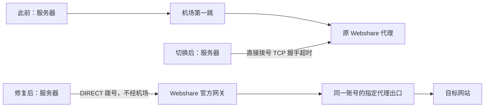

# 仅第二跳发布后 TCP 超时：原因、修复与验证

记录日期：2026-10-26（America/New_York）。故障及修复发生于 2026-10-25 晚间，以下时间均为纽约夏令时 EDT；对应北京时间为 2026-10-26。

本文是既有服务器现场事件复盘，实际端点、账号、出口 IP、配置与备份留在服务器私有目录。公开仓库只记录脱敏原理与操作边界。

## 1. 结论与确定性

最初持续超时的直接原因是：切换到“仅第二跳”后，Mihomo 不再经机场连接 Webshare，而是从服务器直接拨号旧 Webshare IP/端口；这条直连路径无法完成 TCP 握手。绝大多数业务 TCP（包括飞书和 Codex）都依赖这个唯一出口，因而一起失去通信。

已确认故障位置在“服务器到旧代理端点的 TCP 建连”阶段，尚未进入 SOCKS5 认证或目标网站 TLS。现有证据不能定位到具体运营商、云安全组、远端访问策略或中间设备，不能把“链路不通”写成某一方已被证明封锁。

修复没有修通旧 IP 的原始路径，而是换用可从服务器直连的 Webshare 官方 Backbone/Gateway 入口，仍访问同一账号对应的代理出口，不经过机场。原密码及实际出口保持不变。

另外发现两个独立问题：官方域名的系统 DNS 与两家加密 DNS 返回结果不一致；监测的 3 秒建连预算会误判稍慢的正常连接。这两项也已处理，但不能倒推为最初字面量 IP 持续超时的原因。

## 2. 为什么切换模式后才暴露

此前三档模式的 Webshare 节点由机场组拨号；飞书等还可能沿原订阅直连，Codex 的具体流量也应以当时日志为准。因此此前“代理可用”不证明服务器能直接访问 Webshare 的旧 IP/端口。

`ONLY_SECOND_HOP=true` 的优先级最高：业务 TCP 统一使用唯一 Webshare 节点，节点 `dialer-proxy=DIRECT`，不再经过机场；业务 UDP 拒绝，系统维护/内网及回程保护等既有例外仍保留。

这里的 DIRECT 仅表示服务器直接连接 Webshare 入口，不能解释为目标网站绕过代理。Backbone 内部仍有供应商网关转接；“仅第二跳”指不使用原机场第一跳，不宣称物理网络中只有一个转发节点。

## 3. 排查证据

| 检查 | 当时结果 | 能说明什么 |
|---|---|---|
| 飞书 bridge 及 Codex 进程 | 进程仍在；WebSocket、卡片更新出现连接失败 | 进程在线不代表消息链路正常 |
| 发布日志 | 21:08 切换期间本地代理短暂拒绝连接；重启监听后仍有持续超时 | 短暂重启窗口不足以解释后续故障 |
| Mihomo 业务日志 | 飞书、Codex 等统一命中仅 Webshare 节点，拨号旧端点超时 | 故障落在代理入口建连阶段 |
| 绕开 TUN，绑定物理网卡直连旧端点 | TCP 连接超时 | 不能只归因于 TUN 规则或代理进程 |
| 回滚 stable、关闭 TUN 后再次直连 | 仍超时，路由走物理网卡及默认网关 | 未因退出 TUN 恢复旧端点直连 |
| 物理网卡抓包 | 6 个 SYN 发出，无该端点返回包 | 本次窗口内握手没有响应；不是认证失败证据 |
| 主机防火墙 | OUTPUT ACCEPT，UFW 未启用，无匹配的已发现本机出站阻断 | 未发现本机规则阻断；未审计云控制台安全组 |
| 经稳定机场连接同一旧端点 | 可完成 SOCKS5 方法协商 | 端点并非从所有网络都不可达 |
| Mac 绑定物理 en0 连接旧端点 | 可完成 SOCKS5 方法协商 | 不可把经过 Mac TUN 的普通连接冒充直连证据 |
| 官方入口域名解析 | 系统 DNS 与 Google/Cloudflare DoH 不一致 | 存在异常解析证据，具体成因未确定 |
| 两家 DoH 共同返回的官方网关 | 四个候选入口均可从服务器直连 SOCKS5 协商 | 存在不经机场的供应商接入路径 |

旧端点是字面量 IP，原始 TCP 连接不依赖该域名解析。因此 DNS 异常是寻找替代入口时发现的问题，不是原始超时已被证明的原因。TCP 尚未建立时也不能靠更换密码解决。

## 4. 实际修复步骤

1. 读取现场 `control status`、发布状态、桥接及 Mihomo 日志，使用 `tx-mihomo-config-publish` skill 及其维护流程。先 `control rollback` 恢复稳定代理和系统 DNS，保留仅第二跳的源配置意图。
2. 旧 Codex 故障轮次恢复后准备改回三档，为防止并行覆盖，终止该轮 Codex；没有停掉飞书 bridge。后续只按用户要求发布仅第二跳。
3. 查阅 Webshare 官方 Gateway/Backbone 说明。通过已恢复的稳定代理查询两家加密 DNS，核对同一官方域名的共同入口；不把系统 DNS 的异常结果直接当作代理服务器。
4. 先独立验证入口 TCP、SOCKS5 协商、认证、目标 TLS、HTTP 和出口。Backbone 使用控制台对应的账号索引格式，不能机械照搬 Direct 用户名，也不能对任意账号猜测索引。实测同一账号对应出口保持原值。
5. 编辑前私有备份，修改服务器 `~/.config/mihomo/tx/webshare-dns.js` 的入口地址、端口及 Backbone 用户名格式，保持 `ONLY_SECOND_HOP=true`、原密码、`dialer-proxy=DIRECT`。不修改手机或 Mac 正式配置。
6. 同步 `/etc/claude-webshare-watch/config.json`：`webshare_server` 匹配网关入口，`expected_ip` 仍匹配出口；入口 IP 与出口 IP 是不同角色。`checkws` 的“两跳”提示改为“出口”，避免误导当前模式判断。
7. 源 JS 语法、skill `--check`、Mihomo `-t`、最终配置语义断言通过后，带双回滚保护发布。首次已处于 stable 状态，按 skill 重新启用流程使用私有一次性包装复用原发布事务及 `control activate`；未修改安装的 skill/控制器，未强改 phase 或删除保护规则。之后更换实测更快的网关，直接使用原 skill `--check`/`--publish`。
8. 实测监测的 3 秒 TCP/TLS 连接预算会误报，改为 8 秒；现场单次出口请求总预算设为 20 秒。源码、安装副本、checkws 同步，出口精确匹配、模式核对和故障门禁保持原逻辑。分段诊断 trace 自己的时限未改，不能与主检测混淆。
9. 两次切换后用户均确认第二出口新 SSH 成功；最终健康验证后用原 skill `--accept` 保留，两个回滚 timer/service 均 inactive。没有重启服务器；`accept` 不替代首次真实重启后的 `confirm`。

## 5. 文件、验证与版本

| 文件/位置 | 本次相关变化 |
|---|---|
| 服务器私有 `webshare-dns.js` | 仅第二跳开关及 Webshare 接入参数 |
| 私有 watcher 配置 | 网关入口及单次探测总预算；预期出口不变 |
| 私有 `~/.bashrc` | checkws 文案与 8/20 秒预算 |
| `scripts/claude_webshare_watch.py` | 主检测 curl 建连上限由 3 改 8 秒 |
| `docs/webshare-watch.md` | 入口/出口区分及监测预算说明 |
| `AGENTS.md`、`CLAUDE.md` | 当前进度及接续入口；CLAUDE 仅引用 |

最终 active 配置 SHA256：`688f82d802c2ced50a2573d6ace88f9186ea5596add52fce2838397ca8bf196b`。配置 hash 仅用于核对现场版本，不能代替运行证据；真实配置、凭据、备份、抓包不入公开 Git。

2026-10-25 历史现场验证：active 仅一个 SOCKS5 节点、无机场组/provider，业务 TCP 走 Webshare，业务 DoH 经 Webshare；显式代理与 TUN 两种出口查询均匹配原出口；Google HTTP 200、飞书 TLS 正常（首页 404 不是 API 失败）；最终独立 Codex 探针返回 `TX_FINAL_SECOND_HOP_OK`。初期模型目录有超时/TLS 重试，最终模型响应成功，不能写成从未发生重试。

修正主检测预算后连续三次只读检测成功，耗时约 2.79、1.62、2.23 秒；监测状态 healthy=true、gate_blocked=false。完整 13 项 unittest 通过，源码与安装副本一致。第一次 `--probe-only` 因已有定时器持锁没有执行，未将该次算作成功检测。

用户明确确认飞书私聊已正常回复；bridge 日志 21:30:40 run completed、21:30:45 outbound sent，补齐新消息到实际回复的链路证据。不能用单独的进程状态、WebSocket 在线或 CLI 探针替代这一验收。

2026-10-26 本次文档同步另行核对当前 active 版本、清理状态与 watcher 状态，并再次运行仓库检查；不把历史抓包、出口、真实私聊和用户 SSH 结果称作今天重做。

## 6. 后续排障与边界

- 先分清 TCP 建连、SOCKS5 协商、认证、目标 TLS、HTTP、出口匹配各阶段；TCP 超时不是密码错误的证据。
- 直接探测应绑定物理网卡或在已核实的受保护窗口退出 TUN，防止测试流量又被代理接管，形成嵌套代理并得出错误结论。
- 网关地址须来自官方控制台或核实后的可信解析；本次成功不保证地址永久可用。修改入口后先独立测试，再发布。
- 仅第二跳不自动退回机场；失败时业务可能不可用。发布/回滚的系统直连窗口与“运行规则无自动降级”是不同概念。
- 本次没有证明旧端点的原始直连路径已恢复，没有确定具体阻断方；没有重做长期 DNS 抓包、所有容器或新机器重建，也没有验收最终版本的真实重启。
- 监测恢复只解除门禁，不自动重启此前已停止的 Claude 任务。

官方参考：[连接限制与 Gateway](https://help.webshare.io/en/articles/14667636-bypassing-connection-restrictions-connecting-from-china)、[Backbone 接入](https://intercom.help/webshare/en/articles/9658025-how-to-connect-through-a-backbone-connection)、[Proxy Connection API 文档](https://apidocs.webshare.io/proxy-connection)。
